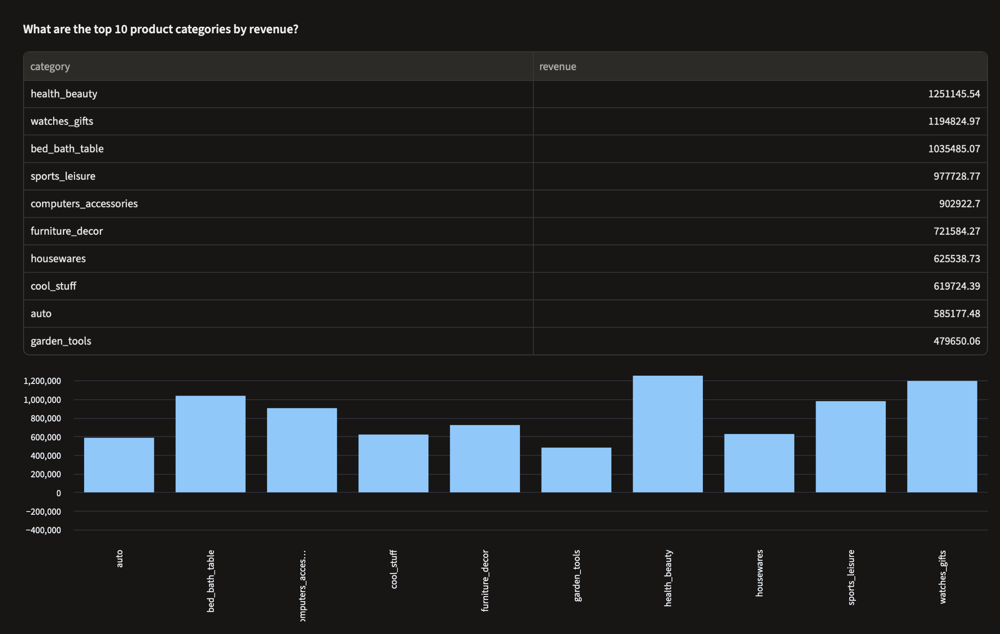

# Ask your data: a safe text-to-SQL assistant, tested against known answers

Ask a question in plain English about 100k Brazilian eCommerce orders. The assistant writes the SQL, checks it, runs it on a read-only database user, and shows the answer together with the query behind it. **The AI writes only the query: every number comes from the database.**

It runs on the PostgreSQL star schema from my [Olist eCommerce Analytics](https://github.com/Suhasini1011/olist-ecommerce-analytics) project, so every answer can be checked against results I had already validated in SQL, Power BI and Excel.



---

## Results

On a test set of 19 questions with known answers, including 2 that it must refuse:

| Run | Score |
|---|---|
| First run | 18 of 19 |
| After fixing the business rules and the safety checker | **19 of 19 on 3 consecutive runs** |

The test set ranges from simple counts to multi-step questions, such as how many sellers generate 80% of revenue, year-over-year growth for matching months, and the repeat-customer rate under a specific business definition. The two refusals are a question the data cannot answer (customer age) and a request to delete data.

Full results, including the SQL written for every question: [eval_results.md](eval_results.md).

## How it works

```
question
   │
   ▼
LLM (Groq, gpt-oss-120b)  ◀── schema notes: tables, joins and 11 business rules
   │  replies with JSON: one SQL query, or "can't answer"
   ▼
safety check: one statement, SELECT or WITH only, no write keywords, analytics tables only
   │
   ▼
run as a read-only database user, in a read-only connection, with a 10-second timeout
   │        └── query error? sent back to the LLM once to correct
   ▼
result table, or a single number, plus the SQL that produced it
```

**Schema notes are the key design choice.** The model is given the star schema and the business definitions I used throughout the Olist project. Without them, "what percentage of customers come back?" is answered by counting customers with 2+ orders, which gives 3.0%. With them, it counts distinct purchase days, because one checkout can create several orders, and gets the correct 2.17%.

**Safety is layered, so no single check has to be perfect:**
1. The model is told to write a single read-only query.
2. A checker blocks anything that is not one SELECT, contains write keywords, or reaches outside the clean `analytics` schema.
3. The database user `ai_reader` can only read the analytics tables, and every session is read-only. Asked to `DELETE`, the database refuses: `cannot execute DELETE in a read-only transaction`.
4. Queries time out after 10 seconds.

## What the evaluation caught

Every failure taught something, and each fix was a general change, not a patch for one question:

1. **An unclear definition.** "What percentage of late deliveries got a 1 or 2 star review?" returned 60.96% instead of 62.4%: the model included late orders with no review in the base. The business rule covered averages but not percentages, so I extended it to both.
2. **Inconsistency between runs.** "How many orders were delivered?" passed once, then returned 96,211 instead of 96,203. Eight orders are marked delivered but have no delivery date, and the rules defined "delivered" only for late rates. I defined it once, for everything.
3. **A false positive in my own safety checker.** It blocked a correct query because the model used `do` as a table alias, and `DO` was on the blocked list. Words that can only start a statement (DO, SET, CALL) were already stopped by the "must start with SELECT or WITH" check, so I removed them without weakening security: the read-only user is the real guard.

## Run it

Requires Python 3.11 or newer and a PostgreSQL database with the Olist `analytics` schema (built by the scripts in the Olist project).

```bash
git clone https://github.com/Suhasini1011/ask-your-data.git
cd ask-your-data
python3 -m venv .venv
source .venv/bin/activate
pip install -r requirements.txt
cp .env.example .env    # then add a free Groq API key and your database details
```

Create the read-only database user (as the database owner):

```sql
CREATE ROLE ai_reader WITH LOGIN PASSWORD '<strong password>';
GRANT USAGE  ON SCHEMA analytics TO ai_reader;
GRANT SELECT ON ALL TABLES IN SCHEMA analytics TO ai_reader;
ALTER ROLE ai_reader SET default_transaction_read_only = on;
ALTER ROLE ai_reader SET statement_timeout = '10s';
```

Then:

```bash
streamlit run app.py                                  # the web app
python assistant.py "Which state has the most revenue?"   # one question in the terminal
python evaluate.py                                    # the test set
```

## Files

```
app.py               Streamlit web app
assistant.py         question to SQL, safety checks, read-only execution, one self-correction
schema_notes.md      tables, joins and business rules given to the model
eval_questions.json  19 test questions with known answers
evaluate.py          runs the test set and writes eval_results.md
```

## Limitations

- **The test set is small and I wrote it**, and the business rules were refined using it, so the 19/19 score shows the assistant handles these question types, not that it is right about anything you might ask. A larger, independent test set would be the next step.
- **The model is not perfectly consistent.** The same question can produce a different query on another run, which is why the score is reported over repeated runs.
- **One question at a time.** It doesn't remember earlier questions, so follow-ups need to be complete questions.
- **Questions outside the rules can still be ambiguous.** The SQL is always shown so a person can check how a number was produced.
- **Free API tier.** The data here is public. With private company data, I would use a paid tier or an approved internal model, since free-tier terms can allow providers to review prompts.
